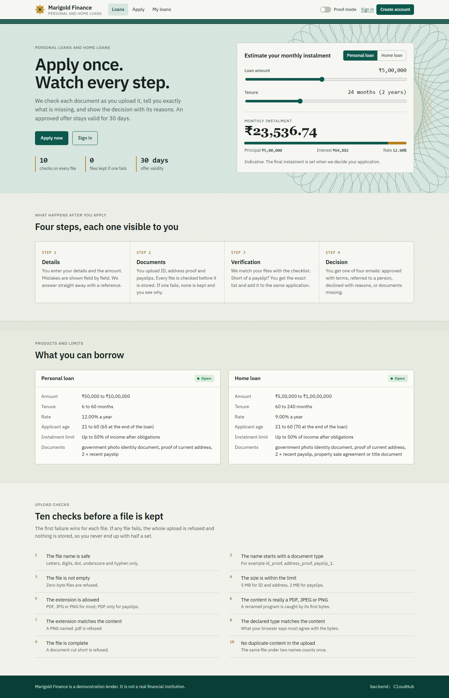
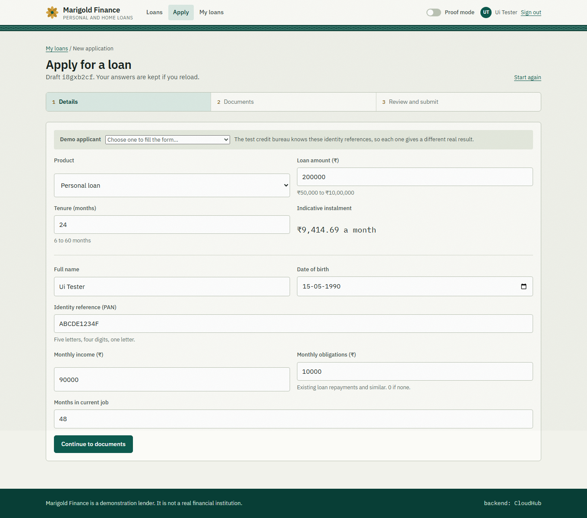
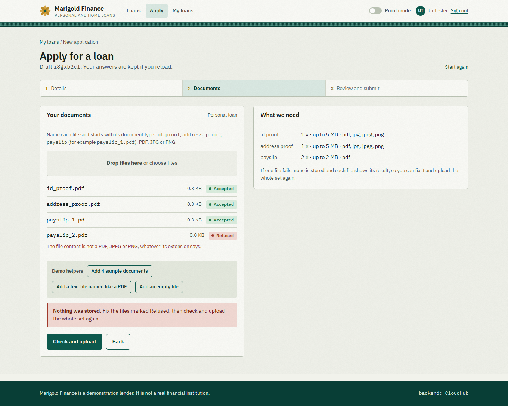
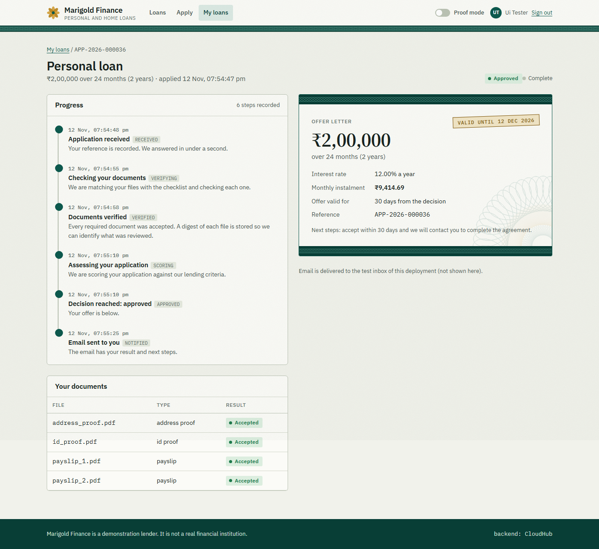
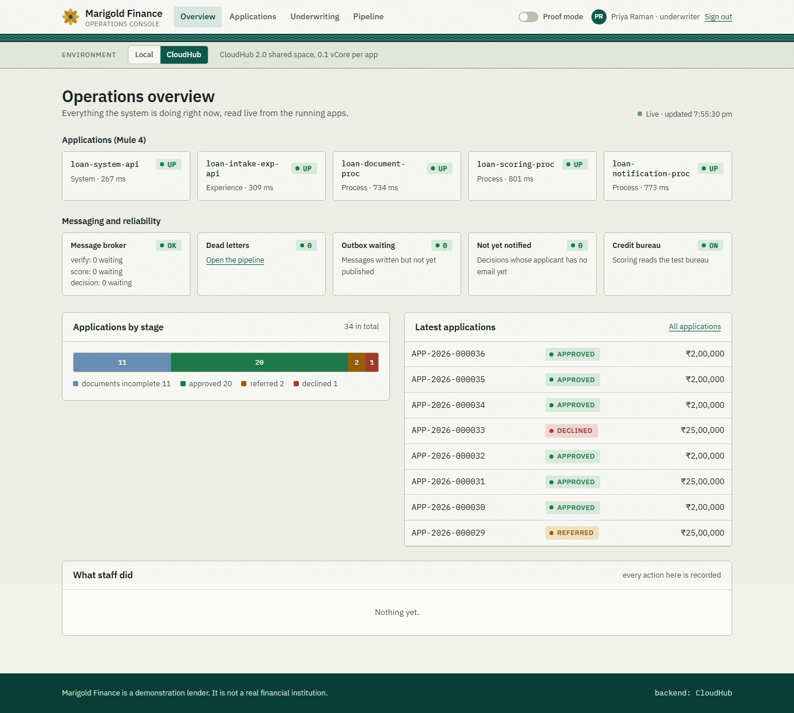
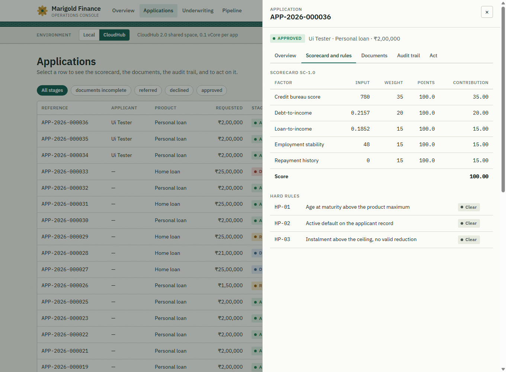
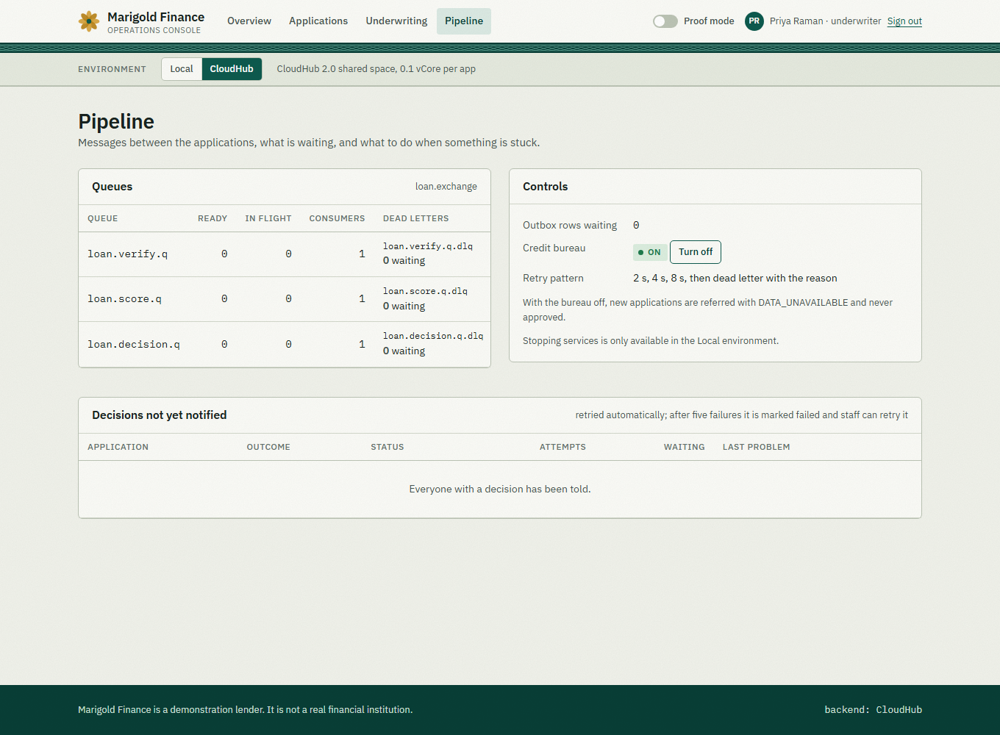
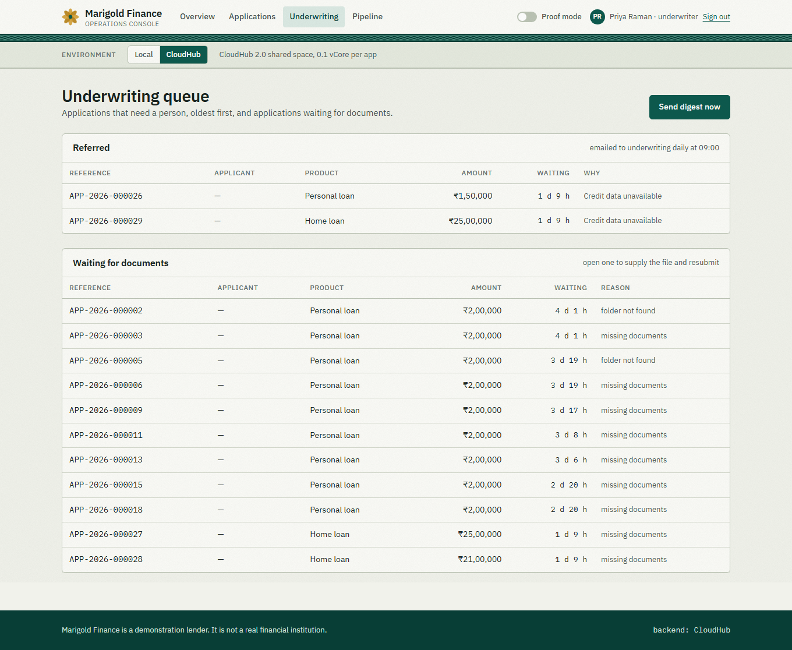
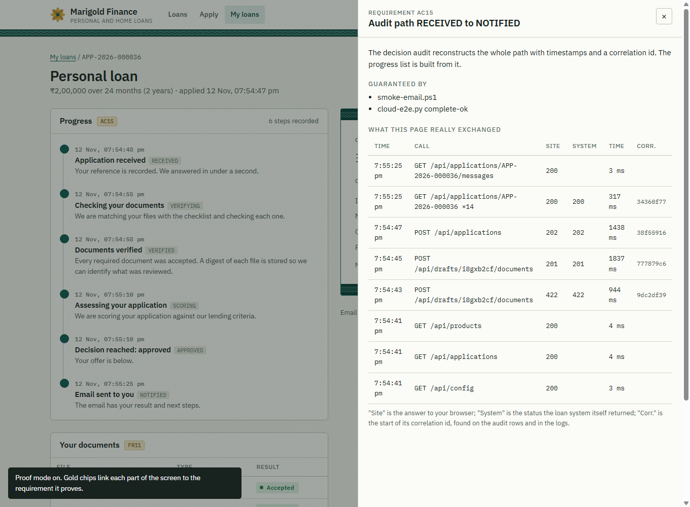
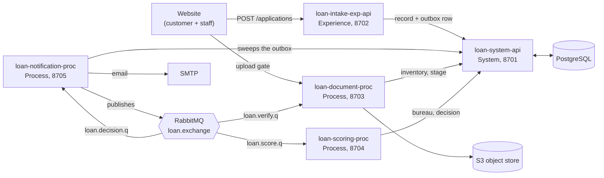

# Banking Loan Application Processing

**A MuleSoft platform that takes a loan application from the first click to a decision email, with every step checked, recorded and explainable, plus a real website on top to use it and to watch it work.**

Cognizant NPN Hackathon, Use Case 22.

    

**Live demo:** https://marigold-finance.onrender.com (runs against the real CloudHub deployment)
The site sleeps when idle, so the first visit can take about 30 seconds. Customer accounts there are temporary. Use the demo applicants listed [below](#try-it-the-demo-applicants).

---

## Contents

1. [What it does](#what-it-does)
2. [Screenshots](#screenshots)
3. [How it works](#how-it-works)
4. [Try it: the demo applicants](#try-it-the-demo-applicants)
5. [What you need](#1-what-you-need)
6. [Run everything on your laptop](#2-run-everything-on-your-laptop)
7. [Prove it works](#3-prove-it-works)
8. [The website](#website-customer-portal-and-staff-console)
9. [Deploy to your own CloudHub 2.0 account](#4-deploy-it-to-your-own-cloudhub-20-account)
10. [Put the website online](#put-the-website-online-render)
11. [Troubleshooting](#5-troubleshooting)
12. [Documentation](#documentation) and [working in this repo](#6-working-in-this-repo)

---

## What it does

An applicant asks for a personal or home loan. The system:

- **accepts** the application in under a second with a reference and a status address, and refuses bad data field by field;
- **checks every uploaded document** before keeping it (ten checks, and if one file fails none is stored);
- **verifies** the documents against the product checklist and, if something is missing, says exactly what and lets the applicant add it to the same application;
- **scores** the applicant asynchronously with a published scorecard, affordability test and hard policy rules;
- **stores an explainable decision** (the factors, their weights and the rules that fired) and an append-only audit trail;
- **emails** the applicant one of four messages: approved with terms, referred to a person, declined with reasons, or documents missing.

It keeps working when parts fail: a broker or mail-server outage delays work but loses none, failed messages retry on a schedule and then wait in a dead-letter queue that staff can replay, and a credit-bureau outage refers the application instead of guessing.

## Screenshots

Taken from the running site against the CloudHub deployment.

### Customer portal

| | |
|---|---|
|  |  |
| **Landing.** Live instalment calculator, products and limits read from the system, and the ten upload checks. | **Apply.** Details are validated on the page and again by the intake API, field by field. |
|  |  |
| **Upload gate.** A text file named like a PDF is caught by its content. The whole set is refused and nothing is stored. | **Live tracker.** Built from the decision audit and updating by itself, ending in the offer letter. |

### Staff console

| | |
|---|---|
|  |  |
| **Overview.** Health of the five apps, queue depths, dead letters, outbox, bureau switch and applications by stage, all read live. | **Scorecard.** The factors add up to the score; each hard policy rule shows whether it fired. |
|  |  |
| **Pipeline.** Queues with their dead letters, the retry pattern, the credit-bureau switch and decisions whose email has not gone out. | **Underwriting.** Referred applications oldest first, and applications waiting for documents. |

### Proof mode



Switch on **Proof mode** and gold chips appear next to parts of the screen. Each opens the requirement it proves, the tests that guarantee it, and the real calls the page just made (status, the loan system's own status and timing, and the start of its correlation id).

## How it works



Only the system API reads or writes the database. Every message is first written to an outbox in the same transaction as the state change, then published by the notification app, so a broker outage cannot lose work.

Five Mule 4 apps in three API-led layers:

| App | Layer | Port | Folder | Job |
|---|---|---|---|---|
| loan-system-api | System | 8701 | `loan-system-api/` | The only app that touches PostgreSQL: applications, outbox, audit, dedupe, bureau mock |
| loan-intake-exp-api | Experience | 8702 | `loan-intake-exp-api/` | Public API. Validates, records the application, answers 202 with a status URL |
| loan-document-proc | Process | 8703 | `loan-document-proc/` | Reads the applicant's documents from the object store, validates every file, takes custody. Also offers an upload endpoint that checks files before storing them |
| loan-scoring-proc | Process | 8704 | `loan-scoring-proc/` | Scorecard SC-1.0, affordability, decision bands, hard policy rules |
| loan-notification-proc | Process | 8705 | `loan-notification-proc/` | Outbox sweeper (batch job), applicant emails, digest |

Messages travel on RabbitMQ: `loan.exchange` (direct) with `loan.verify.q`, `loan.score.q`, `loan.decision.q` and a dead-letter queue for each. Consumers retry after 2, 4 and 8 seconds, then dead-letter the message with the reason.

**Products** (seeded): personal loan PL (50,000 to 10,00,000, 6 to 60 months, 12.00%) and home loan HL (5,00,000 to 1,00,00,000, 60 to 240 months, 9.00%). Applicants must be 21 to 60 years old.

**Decision bands** (scorecard SC-1.0, weights add up to 100): 70 or more **approved**, 50 to below 70 **referred** to a person, below 50 **declined**. Hard rules override the score: HP-01 age at maturity, HP-02 active default, HP-03 instalment above the ceiling with no valid reduction. An offer stays valid for 30 days.

**Documents:** ID proof, address proof and two payslips for both products; a home loan also needs a property document (PDF, 5 MB).

**Production concerns on CloudHub 2.0:** three APIs tracked in API Manager through autodiscovery, with client-id enforcement and spike control; secrets encrypted with secure properties; runtime 4.13.2 EDGE on Java 17 at 0.1 vCore per app.

### Try it: the demo applicants

The test credit bureau knows four identity references. Any other reference has no credit record and is referred as "data unavailable", as is every application while the bureau switch is off.

| Identity reference | Bureau score | Missed payments (24 months) | Active default | Outcome |
|---|---|---|---|---|
| `ABCDE1234F` | 780 | 0 | No | **Approved** (a high amount against a low income gives a reduced offer) |
| `FGHIJ5678K` | 665 | 1 | No | **Referred**: the score is in the review band |
| `LMNOP9012Q` | 540 | 3 | No | **Declined**: the score is too low |
| `RSTUV3456W` | 790 | 0 | Yes | **Declined** by hard rule HP-02 |

On the website's apply form, the **Demo applicant** list fills these in. The documents step has **Demo helpers** that add sample documents, a text file named like a PDF, or an empty file, to show the upload checks.

## 1. What you need

| Need | Notes |
|---|---|
| Windows with PowerShell | The scripts are PowerShell (`.ps1`) plus two Python files |
| Docker Desktop | PostgreSQL, RabbitMQ, MailHog and MinIO run as containers |
| JDK 17 | Temurin 17. Mule 4.12 rejects 21 and 25. `scripts\mvn.ps1` looks in `JDK17_HOME`, the JDK bundled with Anypoint Studio, the one Anypoint Code Builder installs, then a Temurin 17 under Program Files |
| Maven 3.9 | In `MAVEN_HOME`, in `%USERPROFILE%\tools\apache-maven-3.9.9`, or on the PATH |
| Mule 4.12 Enterprise runtime | Installed once by running any app from Anypoint Code Builder (free Anypoint account). Set `MULE_RUNTIME_SOURCE` if it is somewhere else. `run-chain.ps1` copies it to `%USERPROFILE%\tools\mule-local-runtime` (about 450 MB) |
| Python 3 | Only for the CloudHub scripts |
| Node 22.13 or later | Only for the website (no packages to install) |

Nothing secret is needed to run locally. The demo key `LocalDemoKey1234` decrypts the `secure-local.yaml` files and is passed to the runtime at start.

## 2. Run everything on your laptop

Run every command from the repository root.

```powershell
docker compose up -d                          # PostgreSQL, RabbitMQ, MailHog, MinIO
powershell -File scripts\verify-phase1.ps1    # checks the stack, schema, seed data, queues, mail, object store
powershell -File scripts\make-samples.ps1     # generate the test documents
powershell -File scripts\upload-samples.ps1   # copy them into MinIO staging/

powershell -File scripts\run-chain.ps1        # build, deploy and start all five apps in one local Mule runtime
curl.exe http://localhost:8701/api/health     # {"status":"UP","database":"UP"}
```

Stop the runtime with `powershell -File scripts\run-chain.ps1 -Stop`. `-NoBuild` starts with the jars already built. `-Only loan-system-api,loan-intake-exp-api` starts just those apps. Do not start an app from the IDE at the same time: they share the ports. Do not pipe `run-chain.ps1` into another command: the runtime keeps the pipe open and the command never returns.

Then start the website (see [below](#website-customer-portal-and-staff-console)) or call the APIs directly.

### Submit an application

```powershell
$body = @'
{"requestId":"DEMO-1","productCode":"PL","amount":200000,"tenureMonths":24,
 "applicant":{"fullName":"Demo Applicant","dateOfBirth":"1990-05-15","identityRef":"ABCDE1234F","email":"demo@example.com",
 "monthlyIncome":90000,"monthlyObligations":10000,"employmentMonths":48},
 "documents":{"folder":"complete-ok","documentCount":4,"documents":[
  {"fileName":"id_proof.pdf","type":"ID_PROOF"},{"fileName":"address_proof.pdf","type":"ADDRESS_PROOF"},
  {"fileName":"payslip_1.pdf","type":"PAYSLIP"},{"fileName":"payslip_2.pdf","type":"PAYSLIP"}]}}
'@
$body | Out-File demo.json -Encoding ascii
curl.exe -s -X POST http://localhost:8702/api/applications -H "Content-Type: application/json" --data-binary "@demo.json"
curl.exe -s http://localhost:8702/api/applications/<applicationId>/status
```

Open MailHog to read the applicant's email. The sample folders (`complete-ok`, `missing-payslip` and others) come from `make-samples.ps1`; `complete-ok` also holds a property document for home loans. Custody moves accepted files out of staging, so run `upload-samples.ps1` again before reusing a folder.

### Optional: upload the documents through the checking endpoint

Instead of copying files into the bucket, an applicant can upload them to the document app, which checks every file **before** storing it:

```powershell
curl.exe -s -X POST "http://localhost:8703/api/staging/my-folder/documents?product=PL" `
  -F "a=@samples\documents\complete-ok\id_proof.pdf" -F "b=@samples\documents\complete-ok\address_proof.pdf" `
  -F "c=@samples\documents\complete-ok\payslip_1.pdf" -F "d=@samples\documents\complete-ok\payslip_2.pdf"
```

- All files pass: `201`, and the files are stored under `staging/my-folder/` with their own names. Submit the application with `"folder":"my-folder"`; verification runs as usual.
- Any file fails: `422` with a reason per file, and **nothing is stored**. Upload the whole set again.
- Checks, in order: safe file name, name starts with a document type of the product (`id_proof`, `address_proof`, `payslip`, `property_document` for a home loan), not empty, size limit of that type, allowed extension, first bytes are really PDF/JPEG/PNG, extension agrees with the content, declared content type agrees, file is complete (not cut short), no duplicate content in the same upload.
- Bad requests are `400`: folder name not 3 to 64 letters, digits, `_` or `-` (`INVALID_FOLDER`); missing or malformed `product` (`INVALID_PRODUCT`); no checklist for the product (`UNKNOWN_PRODUCT`); no files (`NO_FILES`). More than `verify.maxFiles` (20) files in a folder is `422 TOO_MANY_FILES`.
- To fix a rejected set, upload again. A name that is already in the folder is replaced.
- Copying files straight into the bucket still works; the verification step after the queue runs its own checks either way.

`powershell -File scripts\smoke-upload.ps1` proves all of this live (good set approved, each bad sample refused with the right reason, nothing stored, resubmission, bad requests).

The idea of checking files before storing them comes from Member 3's Google Drive version of the document app, which proved that the storage layer can be swapped behind the same contract.

| UI | URL | Login |
|---|---|---|
| RabbitMQ | http://localhost:15672 | loan / loan |
| MailHog | http://localhost:8625 | none |
| MinIO console | http://localhost:9001 | loan / loan-secret-123 |

These are the throwaway logins of the local Docker containers, not real credentials.

Windows reserves TCP ports 7779 to 8378 on some machines, so the apps use 8701 to 8705 and the MailHog UI uses 8625.

## 3. Prove it works

```powershell
powershell -File scripts\run-all-munit.ps1    # MUnit for all five apps with coverage; needs no running services
```

Expected: 386 tests (73 system, 51 intake, 118 document, 59 scoring, 85 notification), 100% application coverage on every app.

The live checks come in two groups, because the first two assume nothing downstream consumes their test data.

**Group A: only the system API and intake running.**

```powershell
powershell -File scripts\run-chain.ps1 -Stop
powershell -File scripts\run-chain.ps1 -Only loan-system-api,loan-intake-exp-api
powershell -File scripts\smoke-system-api.ps1     # every system API operation
powershell -File scripts\smoke-intake.ps1         # validation, idempotency, 202, status (-WithOutage also proves a 503 when the database is down)
powershell -File scripts\run-chain.ps1 -Stop
```

**Group B: all five apps running** (`run-chain.ps1`, then one script at a time):

| Script | What it proves |
|---|---|
| `scripts\smoke-document.ps1` | document reconciliation, per-file checks, quarantine and custody |
| `scripts\smoke-upload.ps1` | the upload endpoint: files checked before storage, 422 with nothing stored, resubmission, bad requests |
| `scripts\smoke-scoring.ps1` | scoring bands, affordability, hard rules, no sensitive data in logs |
| `scripts\smoke-notification.ps1` | the batch outbox sweep and the decision consumer |
| `scripts\smoke-email.ps1` | all four applicant emails through MailHog, retries, mail-server outage. Stops the mail server on purpose, run it alone |
| `scripts\smoke-resilience.ps1` | resume after a missing document, live checklist change, broker outage. Stops RabbitMQ on purpose, run it alone; runs less than two minutes apart interfere through the checklist caches |

**On CloudHub:** `python scripts\cloud-e2e.py complete-ok` (approved) and `missing-payslip` (documents incomplete), and `python scripts\cloud-upload-e2e.py` for the upload endpoint.

**The website** has its own checks, see [below](#checks).

## Website: customer portal and staff console

A real website sits on top of the system (folder `web/`, no packages to install, Node 22.13 or later). Customers create an account, apply, upload documents through the checking gate, and watch their application move to a decision; staff sign in to a console that reads the running apps and acts on them (supply a missing document and resubmit, replay dead letters, retry a failed email, turn the bureau off, and in Local mode stop the mail server or broker to prove the resilience requirements). Nothing on the pages is canned: every number comes from the Mule apps, the database and the broker.

```powershell
powershell -File scripts\run-web.ps1 -Env local      # the Docker stack and apps from run-chain.ps1
powershell -File scripts\run-web.ps1 -Env cloud      # your CloudHub deployment (settings from ~/.anypoint-cloud.env)
```

Open http://localhost:3000. Staff passwords are written to `web/data/initial-credentials.txt` on the first start (set `WEB_STAFF_PASSWORD` before the first start to choose one). Customers register on the site.

Highlights:

- **Backend for the frontend.** The Mule APIs send no CORS headers and their API client credentials must never reach a browser, so a small Node server (built-in `http`, `fetch`, `node:sqlite`, `crypto`) proxies every call, including the multipart upload.
- **Security.** Passwords hashed with scrypt; sessions in `HttpOnly`, `SameSite=Lax` cookies and stored only as hashes; a custom header plus a matching `Origin` on every state-changing call; a strict content security policy; login attempts limited; customers see only their own applications; identity numbers masked in the console.
- **Local and CloudHub.** Staff can switch the backend from the bar under the header. Local adds the chaos controls.
- **Not built:** a manual underwriting decision. The loan system keeps one decision per application and has no review operation, so the console shows referred applications and sends the digest but does not record a decision.

Full guide: [web/README.md](web/README.md).

### Checks

```powershell
cd web
npm run check     # syntax of every file
npm run smoke     # real accounts, uploads, applications and staff actions against the running backend
npm run ui        # drives headless Chrome through the whole journey (27 checks) and takes screenshots
```

## 4. Deploy it to your own CloudHub 2.0 account

Everything runs in your own accounts, with your own credentials. Nothing in this repository belongs to anyone else's account, and nobody needs to share a password: create the free accounts below and fill in one settings file.

**Accounts (all free tiers are enough)**

| Service | Used for |
|---|---|
| Anypoint Platform trial (anypoint.mulesoft.com) | CloudHub 2.0, Exchange, API Manager |
| Neon (neon.tech) | hosted PostgreSQL. Create a project, then a database called `loan` |
| CloudAMQP (cloudamqp.com), plan "Little Lemur" | hosted RabbitMQ |
| Mailtrap (mailtrap.io) Email Sandbox | catches the applicant emails |
| Backblaze B2 (backblaze.com) | S3-compatible bucket for the applicants' documents. Create a bucket and an application key limited to it |

**One-time Anypoint setup**
1. Find your organization id: Access Management > Business Groups > your organization.
2. Create a Connected App (Access Management > Connected Apps > Create app > "App acts on its own behalf"). Scopes for the Sandbox environment: Deploy Applications, Create Applications, Delete Applications, Read Applications, Download Application, Manage APIs Configuration, Manage Policies, Create Applications in Exchange, Exchange Contributor.
3. Find the environment's own client id and secret: Access Management > Environments > Sandbox. API autodiscovery uses these; the Connected App credentials are not accepted for it.
4. Download `secure-properties-tool.jar` (docs.mulesoft.com, "Secure Configuration Properties") and note its path.

**Settings file.** Copy [cloud/anypoint-cloud.env.example](cloud/anypoint-cloud.env.example) to `%USERPROFILE%\.anypoint-cloud.env` (outside the repository) and fill in every value. Choose any 16 characters for `SECURE_KEY_CLOUD`. Git ignores every `*.env` file and every generated cloud config, so the secrets cannot be committed by accident.

**Steps** (repository root)

```powershell
docker compose up -d                                  # only needed for the sample documents and the local stack
powershell -File scripts\make-samples.ps1
python scripts\setup-cloud.py db                      # schema and seed data into your hosted PostgreSQL
python scripts\setup-cloud.py broker                  # exchange, queues and bindings on your hosted RabbitMQ
python scripts\setup-cloud.py samples                 # sample documents into your bucket under staging/
python scripts\setup-cloud.py api-manager             # publish the API specs, register the three APIs, apply the policies, create a demo client with a contract for each public API
powershell -File scripts\deploy-cloud.ps1 -App all    # system API first, then the other four; each deploy takes a few minutes
python scripts\cloud-e2e.py complete-ok               # APPROVED, one email, three consumer claims
python scripts\setup-cloud.py samples                 # the accepted files leave staging, so upload again
python scripts\cloud-e2e.py missing-payslip           # DOCUMENTS_INCOMPLETE, one email, two claims
```

What the scripts do:
- `setup-cloud.py config` (run for you by the deploy script) generates `config-cloudhub.yaml` from each app's `config-local.yaml` with your hosts, and `secure-cloudhub.yaml` with your passwords encrypted under your own key. The key reaches the apps as the secure property `secure.key`.
- The poms carry the placeholder `ANYPOINT-ORG-ID` as group id. The deploy script builds from a temporary copy with your organization id, publishes the application to your Exchange, then deploys that asset to the shared space.
- The runtime is 4.13.2 EDGE with Java 17 (the trial rejects 4.12). The poms still say 4.12.3: the app is built against that and runs on the newer runtime, which is chosen at deploy time by `-MuleVersion`. Each app uses 0.1 vCore, so all five fit in the 1 vCore of a trial Sandbox. If your shared space has another name or region, set `CLOUD_TARGET` in the settings file or pass `-Target`.
- API Manager: three APIs are tracked through autodiscovery: the intake API, the system API and the document upload API (`POST /api/staging/{folder}/documents`). Policies: the intake API and the document upload API have client-id enforcement and spike control (20 and 10 requests per second); the system API has spike control. A call to a public API needs the `client_id` and `client_secret` headers of an application with a contract; `api-manager` creates one (`loan-portal-demo`, with a contract for both public APIs) and stores its credentials in your settings file. The document app starts only after its API has been tracked, so run `api-manager` and `config` before deploying it.
- Alerts: in Runtime Manager > Alerts, create a "Deployment failed" alert for the five apps (the trial offers no other conditions).

Check a deployment by hand:

```powershell
curl.exe https://<system-api-url>/api/health                                       # {"status":"UP","database":"UP"}
curl.exe -i https://<intake-url>/api/applications/APP-1/status                     # 401 without credentials
curl.exe -i -X POST "https://<document-url>/api/staging/abc123/documents?product=PL"   # 401 without credentials
curl.exe -i -H "client_id: <id>" -H "client_secret: <secret>" https://<intake-url>/api/applications/APP-1/status    # 404 for an unknown application
```

## Put the website online (Render)

The website is a small Node server, so it needs a host that runs one (Vercel and GitHub Pages serve static files only). [render.yaml](render.yaml) describes the service for [Render](https://render.com); secrets are entered in the dashboard and never stored in this repository.

1. Run `powershell -File scripts\make-render-env.ps1`. It writes `render-web.env` in your home folder with only the settings the site needs (CloudHub addresses, API client id and secret, broker login, a staff password).
2. On Render: New > Blueprint, pick this repository and the `frontend-web` branch.
3. Add the values with Environment > Add from .env, then delete the file.

On the free plan the service sleeps when idle and customer accounts are lost when it restarts (the staff accounts are created again). Add a disk on a paid plan to keep them. Details: [web/README.md](web/README.md).

## 5. Troubleshooting

| Symptom | Cause and fix |
|---|---|
| `Port 870x is busy` | An app runs from the IDE or from an earlier runtime. Stop it, or `run-chain.ps1 -Stop` |
| `JDK 17 not found` / `Maven 3.9 not found` / `Mule runtime not found` | Install it or set `JDK17_HOME` / `MAVEN_HOME` / `MULE_RUNTIME_SOURCE` |
| A smoke script reports `FOLDER_NOT_FOUND` or an unexpected `DOCUMENTS_INCOMPLETE` | The earlier run consumed the staging files. Run `upload-samples.ps1` again |
| Every call to a local app answers an empty 503 | The API gateway blocks an app that has an `api.id` property but no API Manager. Keep `api.id` only in `config-cloudhub.yaml` |
| A CloudHub app stays in APPLYING | Runtime Manager > the app > Logs. Autodiscovery needs the environment client id and secret and an API instance (`setup-cloud.py api-manager` before the first deploy); a policy needs an implementation for the runtime version |
| "Runtime version not supported for this target" | The trial accepts only 4.13.x EDGE and 4.9.x. Pass `-MuleVersion` |
| Every application is referred | The bureau switch is off, or the identity reference is not one of the four the test bureau knows. Turn the bureau on in the staff Pipeline page, or use a demo applicant |
| A document added later shows as "unexpected" | The system only recognises files named in the original submission. The website declares the missing files at submit time; name the file exactly as the tracker says |
| `scripts\run-web.ps1` "does not exist" | Run it from the repository root, or from `web` use `..\scripts\run-web.ps1` or `npm start` |

## Documentation

| Document | Content |
|---|---|
| [docs/HLD.md](docs/HLD.md) | High-level design: architecture, data model, flows, security, requirement traceability |
| [docs/decisions.md](docs/decisions.md) | Design decisions and the reasons for them |
| [docs/negative-scenarios.md](docs/negative-scenarios.md) | What happens when things go wrong, and the test that proves it |
| [docs/versions.md](docs/versions.md) | Tool and runtime versions |
| [docs/config-pattern.md](docs/config-pattern.md) | How configuration and secrets are organised |
| [docs/git-evidence.md](docs/git-evidence.md) | Branching and merge-conflict evidence |
| [web/README.md](web/README.md) | The website: run, accounts, features, security, checks |

## 6. Working in this repo

- One folder per Mule app. Work on short branches named `feature/<app>-<topic>` and merge by pull request. The website lives on `frontend-web`.
- Contracts between apps (system API RAML, queue names and message envelope, stages, reason codes, error body) change only after agreement, in a pull request labelled `contract`.
- Never commit `target/`, `.mule/`, `.studio/`, a real encryption key, a settings file or any credential.

## Credits

Built solo by [@Aritraghoshdastidar](https://github.com/Aritraghoshdastidar) for the Cognizant NPN Hackathon. The idea of checking uploaded files before storing them was adapted from Member 3's Google Drive version of the document app. "Marigold Finance" is a fictional lender used for the demonstration website; it is not a real financial institution.
