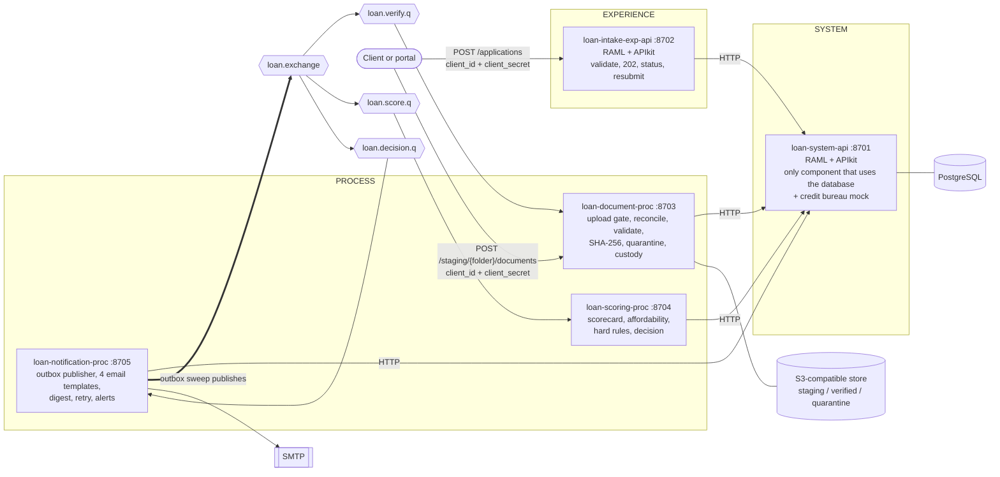
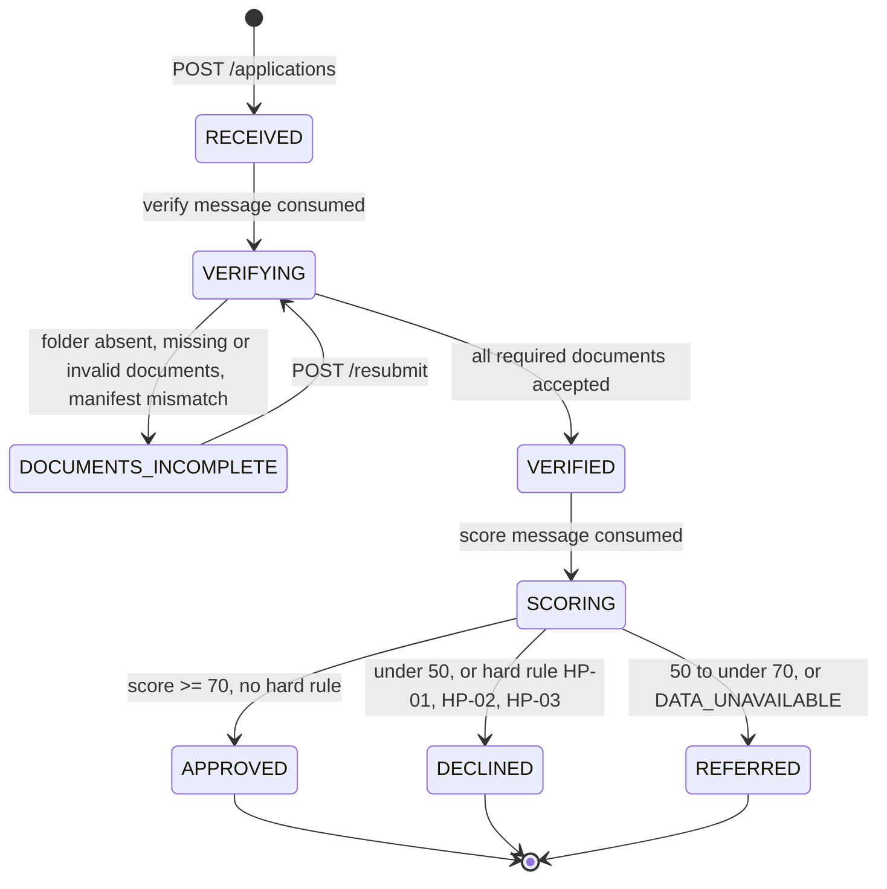
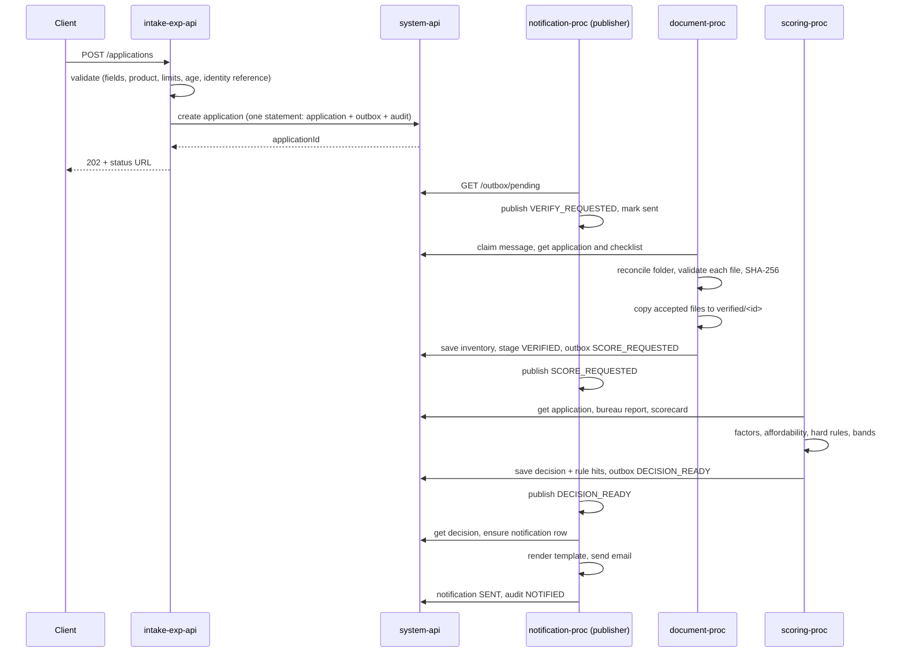
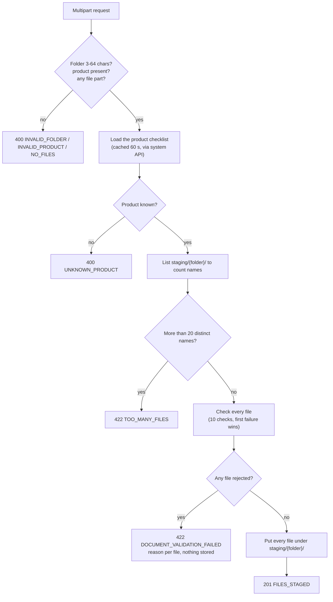
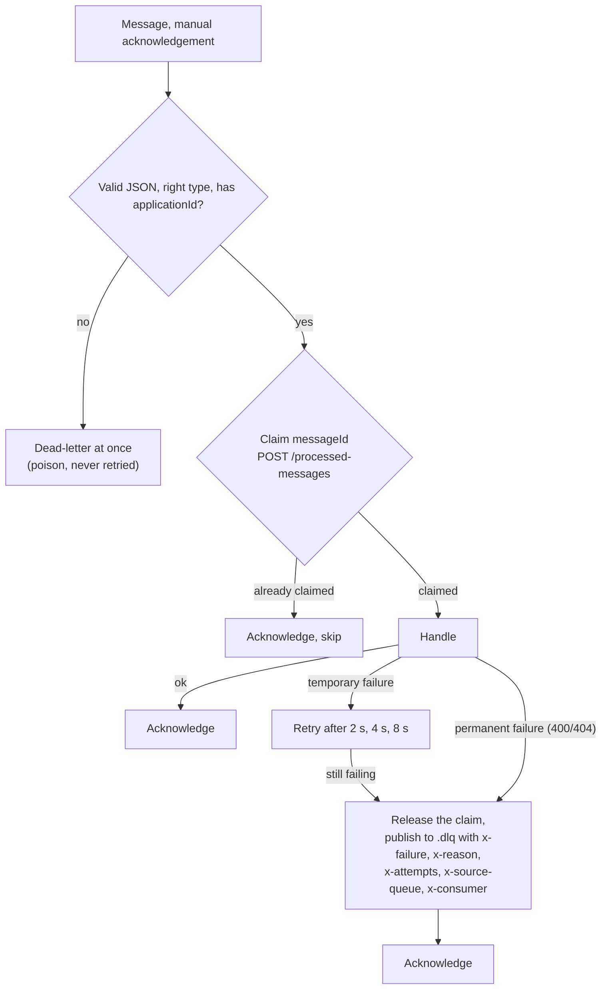
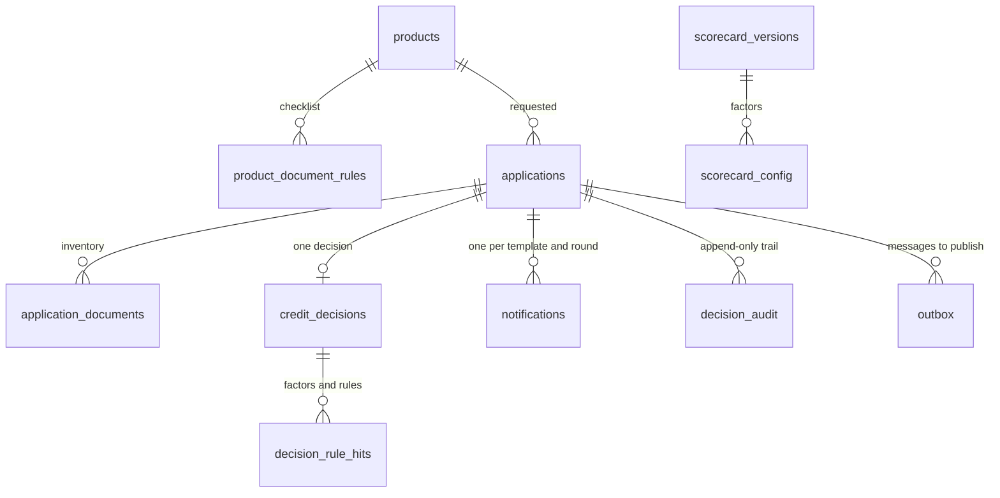
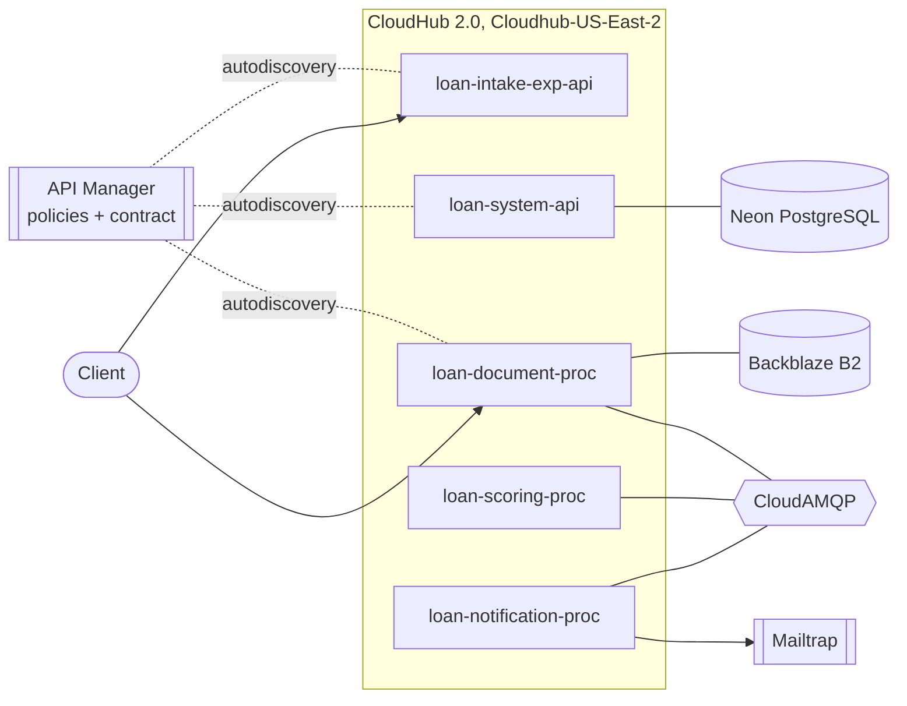

# High Level Design: Loan Application Processing

**Version:** 1.0 (final) · **Date:** 9 November 2026 · **Author:** Aritra Ghosh Dastidar
**Challenge:** Cognizant NPN Hackathon, Use Case 22, Banking Loan Application Processing (MuleSoft)
**Status:** all five applications are built, tested and deployed to CloudHub 2.0. This document describes the system as delivered.

Contents: 1 Purpose and scope · 2 Architecture · 3 Application lifecycle · 4 Components · 5 Messaging · 6 Data · 7 Cross-cutting design · 8 Security · 9 Deployment · 10 Testing · 11 Requirements traceability · 12 Decisions, limits and risks · 13 Change log · Appendices

---

## 1. Purpose and scope

The platform accepts loan applications over HTTP, reconciles the uploaded supporting documents against a per-product checklist, scores credit asynchronously with an explainable scorecard, keeps an auditable decision, and emails the applicant one of four outcomes: **APPROVED, DECLINED, REFERRED, DOCUMENTS_MISSING**.

Design drivers, taken from the brief:

| # | Driver | How the design answers it |
|---|---|---|
| 1 | The file system sits in the middle of the flow: the payload only references documents uploaded separately | A process app reconciles the manifest, the product checklist and the folder contents; an optional upload gate checks files before they are stored |
| 2 | Missing documents are a business outcome, not an error to retry | `DOCUMENTS_INCOMPLETE` is a stage with a reason and an exact list, an email, and a resubmission path |
| 3 | Scoring is a regulated decision | Scorecard version, every factor with value, weight and contribution, every hard rule, reason codes and timestamps are stored; the audit table is append-only |
| 4 | Fast acknowledgement | The intake API validates, records and answers `202`; it never reads a document or scores |
| 5 | Never approve on incomplete data | Unreadable bureau or history gives `REFERRED` with `DATA_UNAVAILABLE` |
| 6 | Safe under redelivery and failure | Transactional outbox, idempotency keys at every level, manual acknowledgement, bounded retry, dead-letter queues |

Out of scope: a real credit-bureau integration (a mock with an on/off switch is used), OCR of documents, an applicant-facing UI, payment disbursement.

## 2. Architecture

API-led connectivity, three layers, five Mule 4 applications, three queues (each with a dead-letter queue), one PostgreSQL database, one S3-compatible document store, one SMTP server.



| Layer | App | Port | Responsibility |
|---|---|---|---|
| Experience | `loan-intake-exp-api` | 8702 | Public API: validate, idempotent intake, `202` and status URL, status, resubmit |
| Process | `loan-document-proc` | 8703 | Queue consumer for `loan.verify.q`; reconcile, validate, quarantine, custody; optional upload gate |
| Process | `loan-scoring-proc` | 8704 | Queue consumer for `loan.score.q`; bureau call, scorecard, affordability, hard rules, decision |
| Process | `loan-notification-proc` | 8705 | Queue consumer for `loan.decision.q`; four emails, retry, digest, alerts; **also the publisher of every outbox message** |
| System | `loan-system-api` | 8701 | The only application that talks to PostgreSQL; hosts the bureau mock |

**Why this shape**
- **Queues between process apps** isolate slow work (bureau call, large document sets) from the API response.
- **One system API owns the database**, so business operations are atomic (for example "create the application, its outbox message and its audit row" is one statement) and SQL lives in one place.
- **Every business change that must cause a message writes the message in the same transaction** (transactional outbox). One component, the notification app, publishes those rows to the broker, so no application needs to be both a database writer and a broker writer for the same fact.
- **Each app deploys and tests on its own**: sample messages and `curl` are enough to exercise any one of them.

## 3. Application lifecycle



- A stage describes the **loan only**. Notification progress is tracked separately (`PENDING`, `RETRYING`, `SENT`, `FAILED`), so an approved loan stays approved when email is down.
- `NOTIFIED` is not a stage. It is the audit event written when a notification reaches `SENT`.
- `DOCUMENTS_INCOMPLETE` is the application stage everywhere; `DOCUMENTS_MISSING` is the name of the fourth outcome and of its email template.
- Reasons for `DOCUMENTS_INCOMPLETE`, in order of precedence: `FOLDER_NOT_FOUND`, `MISSING_DOCUMENTS` (including invalid files), `MANIFEST_MISMATCH`.

### Happy path



### Documents incomplete and resubmission

```mermaid
sequenceDiagram
    participant A as Applicant
    participant D as document-proc
    participant S as system-api
    participant N as notification-proc
    D->>D: reconcile: one PAYSLIP found, two required
    D->>S: stage DOCUMENTS_INCOMPLETE (reason, exact list in audit detail) + outbox DECISION_READY
    N->>A: email: PAYSLIP, 2 required, 1 found, how to supply it
    A->>D: upload payslip_2.pdf to the same folder
    A->>S: POST /applications/{id}/resubmit (via intake)
    S->>S: only from DOCUMENTS_INCOMPLETE; one concurrent winner; outbox VERIFY_REQUESTED
    D->>D: accepted files reused (not re-checked, not re-quarantined), new file checked
    D->>S: stage VERIFIED, scoring continues on the same application
```

## 4. Component design

### 4.1 loan-intake-exp-api (experience)

- RAML-first with the APIkit router. Endpoints: `POST /applications`, `GET /applications/{id}/status`, `POST /applications/{id}/resubmit`.
- Validation: mandatory fields (400 with field-level errors), identity reference format (400), unknown product (422), amount or tenure outside the product limits (422 stating the limits), applicant age outside the permitted range (422). Age **at maturity** is deliberately not checked here: it is hard rule HP-01 at scoring.
- Idempotency: the client `requestId` is the key. The same id with the same payload returns the original `applicationId`; the same id with a different payload returns `409`. The manifest folder is checked against path traversal (`..`, leading `/`, backslash) and rejected with 400.
- The flow only validates and writes. A database failure returns `503`, never a false `202`.
- Registered in API Manager with client-id enforcement and spike control (section 8).

### 4.2 loan-document-proc (process)

Two entry points that meet in the object store.

**A. The upload gate (optional way in).** `POST /api/staging/{folder}/documents?product=PL`, multipart, one part per file. Every file is checked before anything is stored. If any file fails, the answer is `422` with a reason and a plain-language message per file and **nothing is stored**; if all pass, the files are put under `staging/{folder}/` with their own names and the answer is `201`.



The per-file checks, in order: safe file name; name starts with a document type of the product; not empty; size within the limit of that type; allowed extension; first bytes really are PDF, JPEG or PNG; extension agrees with the content; declared content type agrees; the file is complete (end marker present); no duplicate content within the upload. The design of checking before storing comes from a teammate's Google Drive version of this app; the checks are in `dwl/uploadChecks.dwl`. Copying files straight into the bucket remains possible, and the verification below checks them again either way.

**B. Verification from the queue** (`loan.verify.q`, message `VERIFY_REQUESTED`):

1. Claim the message (`POST /processed-messages`); a duplicate is acknowledged without handling.
2. Move `RECEIVED` to `VERIFYING` (a message for an application already past that stage is skipped).
3. Read the product checklist (cached 60 s, so an edit in the database applies without redeployment).
4. List the applicant folder `staging/{folder}/`. A prefix with no object at all is an absent folder (`FOLDER_NOT_FOUND`); a folder holding only its marker is empty, so every required type is missing. A folder name with `..`, a leading `/` or a backslash is never listed.
5. Classify every entry: expected and present, expected and missing, present but unexpected (recorded, ignored, never blocks). Files in sub-folders are unexpected.
6. Validate each present file with a **parallel for-each (3 at a time)**, cheapest check first and nothing read when not needed: *stable* (older than 3 s and the same size as the last sighting, held in an object store; otherwise a temporary error and the consumer retry), extension, size from object metadata (never loaded in full), content type from the first 16 bytes and completeness from the last 1,024 bytes, and only then the SHA-256 by streaming. Duplicate content (same digest) counts once.
7. Quarantine failures: copy to `quarantine/{applicationId}/`, save the inventory with the reason, and only then remove the staging copy. Files accepted in an earlier round are reused.
8. Compare the declared document count and any declared SHA-256 values with what was found; a difference is `MANIFEST_MISMATCH` and nothing is moved.
9. If incomplete: stage `DOCUMENTS_INCOMPLETE` with the exact list (type, required, found, missing files, rejected files and reasons, duplicates, manifest differences) and an outbox `DECISION_READY` for the notification.
10. If complete: copy the accepted files to `verified/{applicationId}/`, record source path, stored path and digest per file, mark the application `VERIFIED` with an outbox `SCORE_REQUESTED`, and only then remove the staging copies. Documents are never modified in place; a failed cleanup is logged because the verified copy is the record.

### 4.3 loan-scoring-proc (process)

Consumes `loan.score.q` (`SCORE_REQUESTED`). **Decision order:** (1) bureau or history unreadable gives `REFERRED` / `DATA_UNAVAILABLE` and stops; (2) hard rules; (3) score bands.

Hard rules: **HP-01** age at maturity above the product maximum (declined); **HP-02** an active default on the applicant's history (declined, regardless of score); **HP-03** instalment above the product ceiling with no valid reduced amount (declined).

**Scorecard SC-1.0** (data, not code): five factors, linear points between two end values, contribution = weight × points / 100, score = sum of contributions.

| Factor | Weight | 0 points at | 100 points at |
|---|---|---|---|
| Credit bureau score | 35 | 600 or less | 750 or more |
| Debt-to-income (obligations + new instalment over income) | 20 | 60% or more | 30% or less |
| Loan-to-income (amount over annual income) | 15 | 5× or more | 1× or less |
| Employment stability (months in job) | 15 | 6 or less | 36 or more |
| Repayment history (missed payments in 24 months) | 15 | 3 or more | none |

**Affordability.** `instalment = P·r(1+r)^n / ((1+r)^n − 1)`, `r = annual rate / 1200`, rounded half-up to 2 decimals. Net income = declared income − declared obligations. If instalment / net income exceeds the product ceiling, the amount is reduced to the largest multiple of the product step (1,000) that fits and approved with reason `AFFORDABILITY_REDUCED` when it is still at least the product minimum; otherwise HP-03 declines. Net income of zero or less is HP-03, and no ratio is invented. The ratio is stored as a decision input.

**Bands.** 70 or more `APPROVED`, 50 up to 70 `REFERRED`, under 50 `DECLINED`, inclusive at the lower edge, thresholds read from the scorecard row. An approval stores amount, tenure, rate, instalment, any reduction reason, and an offer valid for 30 days. Every factor and rule hit is stored with value, weight, points and contribution; one decision per application is enforced by the primary key.

**Worked example.** `ABCDE1234F`, 200,000 over 24 months at 12%: score 100, `APPROVED`, instalment 9,414.69. 500,000 over 36 months with income 50,000 and obligations 20,000 is approved at a reduced 451,000 (instalment 14,979.65) with `AFFORDABILITY_REDUCED`.

### 4.4 loan-notification-proc (process)

Four jobs in one app, each a separate flow:

| Job | Trigger | What it does |
|---|---|---|
| **Outbox publisher** | Scheduler (5 s local, 15 s cloud) | A Mule **batch job** (`outbox-sweep-batch`, blocks of 10) reads pending outbox rows from the system API and publishes each to `loan.exchange`; a failed publish is recorded and left pending. A lock in the object store stops two sweeps overlapping and expires on its own |
| **Decision consumer** | `loan.decision.q` (`DECISION_READY`) | Ensures one notification row per application, template and round, renders the template for the outcome, sends the email, records `SENT` and the `NOTIFIED` audit event |
| **Retry and alert** | Schedulers (20 s retry, 30 s alert) | A failed email is retried with growing waits (10 s base, up to 5 attempts), then `FAILED` and an error-level alert; unnotified decisions older than 60 s are logged as alerts and listed at `GET /api/unnotified` |
| **Underwriting digest** | Cron 09:00 daily and `POST /api/digest` | Emails the underwriting team the `REFERRED` applications awaiting a decision with their age and amount, oldest first |

Templates: **APPROVED** (amount, term, rate, instalment, offer expiry, next steps, any reduction and its reason), **DECLINED** (principal reasons in plain language and the right to a review, with where and when; **no scores, thresholds or rule identifiers**), **REFERRED** (decision expected within 3 working days), **DOCUMENTS_MISSING** (each missing type with required and found counts, files named but absent, rejected files with reasons, duplicates, manifest differences, and how to resubmit). SMTP failure keeps the decision and its audit and retries only the notification; the application is never rescored.

### 4.5 loan-system-api (system)

- RAML contract with 24 business-level operations; only this application opens JDBC connections (pool of 5, 10 s maximum wait).
- **Applications:** `POST /applications` (application, outbox row and audit row in one statement, idempotent on request id), `GET /applications/{id}`, `GET /applications?stage=&limit=`, `PUT /applications/{id}/stage` (expected-stage guard, row lock, audit and optional outbox message in one statement), `POST /applications/{id}/resubmit` (only from `DOCUMENTS_INCOMPLETE`, one concurrent winner), `PUT /applications/{id}/documents` (inventory upsert in one transaction), `POST /applications/{id}/decision` (decision, rule hits, stage change, audit and `DECISION_READY` outbox row in one transaction; a repeat changes nothing), `GET /applications/{id}/audit`.
- **Reliability:** `GET /outbox/pending`, `POST /outbox/{id}/sent`, `POST /outbox/{id}/failed`, `POST /processed-messages` (claim), `DELETE /processed-messages/{consumer}/{messageId}` (release), `POST /audit/events`.
- **Reference data and mocks:** `GET /products/{code}`, `GET /products/{code}/document-rules`, `GET /scorecards/active`, `GET /bureau/reports/{identityRef}` (503 while the switch is off, 404 for an applicant without history), `GET` and `PUT /bureau/switch`.
- **Notifications:** `POST /notifications`, `PUT /notifications/{id}`, `GET /notifications` (unnotified rows with their age).
- The document inventory save checks the application exists **inside** the same transaction as the writes. Reading outside a transaction and then opening one would hold two connections per request and exhaust the pool under concurrent calls; a burst of 20 simultaneous saves is part of the smoke test.
- Request logging masks identity numbers (the bureau mock takes the number in the path for simplicity; a real bureau integration would use a request body).

### 4.6 Website: customer portal and staff console (`web/`)

Not part of the five Mule applications; it is a client of them. A small Node server (no dependencies) and a single-page browser app.

- **Why a server of its own:** the Mule APIs send no CORS headers, and the API client credentials of the policies must never reach a browser. The server holds the credentials, calls the intake, document, system and notification apps, reads the broker's management API for queue depths and dead letters, and reads the mail catcher in Local mode.
- **Accounts:** the loan system has no user accounts, so the site keeps its own SQLite database of accounts (scrypt hashes), sessions (hashed tokens in an `HttpOnly` cookie) and which application belongs to which customer. Roles: customer, underwriter, operations.
- **Customer journey:** apply (the application id the intake API receives is built from the account and a draft id, so a double submit is idempotent), upload through the document upload gate, then a live tracker built from the decision audit; a missing-documents application is fixed on the same reference by uploading and resubmitting. The customer view shows decisions in plain language with no scores or rule ids.
- **Staff console:** live health of the five apps, queues and dead letters, outbox, unnotified decisions, applications by stage, an application drawer (scorecard factors summing to the score, hard rules, documents with digests, audit trail), actions (supply a file and resubmit, send the digest, replay dead letters, bureau switch) and, in Local mode only, stopping and starting the mail server and the broker. Every staff action is recorded.
- **Proof mode:** requirement chips on the screens open the requirement, the tests that guarantee it, and the real calls the page made with the loan system's own status, timing and correlation id.
- **Environment switch:** one site, two backends (Local, CloudHub), chosen by the server and switchable by staff.
- **Limits:** no manual underwriting decision (the loan system keeps one decision per application and has no review operation); the customer's email is shown in Local mode only.

## 5. Messaging design

| Queue | Dead-letter queue | Producer | Consumer | Message type |
|---|---|---|---|---|
| `loan.verify.q` | `loan.verify.q.dlq` | intake, resubmit | document-proc | `VERIFY_REQUESTED` |
| `loan.score.q` | `loan.score.q.dlq` | document-proc | scoring-proc | `SCORE_REQUESTED` |
| `loan.decision.q` | `loan.decision.q.dlq` | scoring-proc, document-proc (incomplete outcome) | notification-proc | `DECISION_READY` |

All six queues are bound to the direct exchange `loan.exchange` with their own name as routing key. (In practice every message is first an outbox row; the notification app is the publisher.)

**Envelope** (ids only, never identity numbers or income): `{ messageId, correlationId, applicationId, type, attempt, createdAt }`. Consumers read details from the database.

**One consumer pattern** (a reusable flow copied into the three consumer apps; the differences are the queue and the handler):



If the dead-letter publish itself fails, the message is rejected back onto the queue and never lost. A message that is repeated or late for an application already past the stage it is for is skipped without a call. A dead-lettered message keeps its original body and the failure headers, so once the cause is fixed it can be published back to its source queue, and the released claim lets it be handled again.

## 6. Data design (PostgreSQL)

14 tables, defined in `db/schema.sql`, seeded by `db/seed.sql`:

| Group | Tables |
|---|---|
| Reference | `products`, `product_document_rules`, `scorecard_versions`, `scorecard_config`, `applicant_history`, `system_flags` |
| Transactional | `applications`, `application_documents`, `credit_decisions`, `decision_rule_hits`, `notifications` |
| Reliability and audit | `outbox`, `processed_messages`, `decision_audit` |



Products in the seed: **PL** personal loan (50,000 to 1,000,000; 6 to 60 months; 12.00%; applicant age 21 to 60; 65 at maturity; instalment ceiling 50% of net income) and **HL** home loan (500,000 to 10,000,000; 60 to 240 months; 9.00%; age 21 to 60; 70 at maturity). Checklist: ID proof, address proof, two payslips (2 MB limit); home loan adds a property document.

Integrity rules that carry the design:
- `applications.request_id` UNIQUE: idempotent intake.
- `credit_decisions.application_id` PRIMARY KEY: one decision per application, so a redelivered scoring message changes nothing.
- `notifications (application_id, template, round)` UNIQUE: one email per outcome per verification round; a resubmission may legitimately need a new documents-missing email.
- `processed_messages (consumer, message_id)` PRIMARY KEY: consumer-level deduplication.
- `application_documents`: unique `(application_id, source_path)` for safe re-verification; a partial unique index on `(application_id, sha256)` for accepted files counts duplicate content once.
- `decision_audit` is **append-only**, enforced by a trigger that rejects UPDATE and DELETE.
- The checklist, product limits, scorecard weights and thresholds are **data**: they change with no redeployment, and every decision records the scorecard version it used.

## 7. Cross-cutting design

### 7.1 Reliability and idempotency
- **Transactional outbox:** the message to publish is written in the same transaction as the business change. A broker outage never leaves an accepted application without a verification path: it waits in the outbox with the failure recorded and is published once when the broker is back.
- **Idempotency at four levels:** request id (intake), unique decision key (scoring), unique notification key (notification), processed-message claim (every consumer). Database keys are the real guard because they survive restarts.
- **Conservative degradation:** no readable bureau or history means `REFERRED`, never `APPROVED`.
- **Order of side effects** in document handling: copy first, save the record, remove the original last, so a failure part-way leaves the file in staging and the whole step simply runs again.

### 7.2 Error handling
Every application has a named `global-error-handler` set as the default. Dependency failures (system API, broker, object store, mail server, database) answer `503 SERVICE_UNAVAILABLE`; everything else `500 INTERNAL_ERROR`. The system API and the intake API also map `400, 404, 405, 406, 409, 415, 422, 501`. Business errors are raised in one place (`sf-raise-app-error`). The response never carries a message from a dependency or a submitted value; the log line carries only status, error type and correlation id.

### 7.3 Logging, alerts and monitoring
- **Levels:** `ERROR` for poison messages, dead-letters, failed settlement, unreleased claims, alerts and the global handler; `WARN` for retryable trouble; `INFO` for requests and milestones. Every logger has a category `com.loan.<app>.<area>` so output can be filtered. HTTP wire logging is `WARN` (off for the bureau request).
- **Correlation id** on every request, log line, message and audit row. The path RECEIVED, VERIFYING, VERIFIED, SCORING, outcome, NOTIFIED can be rebuilt from `decision_audit` (`GET /applications/{id}/audit`).
- **Health:** `GET /api/health` on every app.
- **Alerts:** a Runtime Manager alert "Loan apps deployment failed" (critical, all Sandbox applications, email); in-app error-level alerts for unnotified applicants and for a notification that gave up, plus the `GET /api/unnotified` list. Anypoint Monitoring alerts and the API Manager Alerts tab are not available on the trial account, and CloudHub 2.0 Runtime Manager offers only deployment success and failure alerts; the in-app alerts cover the rest.
- **Privacy:** identity numbers, income figures, e-mail addresses, names and document content never reach a log; scans of all five logs are part of the smoke tests.

### 7.4 Configuration
`config-{env}.yaml` (plain) and `secure-{env}.yaml` (encrypted), selected by the `mule.env` property (`local` or `cloudhub`). DataWeave lives in `.dwl` files and modules. SQL lives in the system API. The same code runs on a laptop and on CloudHub; only the files and the run-time key differ. The cloud files are **generated** by `scripts/setup-cloud.py config` from the local ones, so a teammate can deploy to their own account without copying anybody's file.

### 7.5 Components used where they fit
Parallel for-each (file validation, 3 at a time), for-each (outbox, custody, quarantine, upload storage), **batch job** (outbox sweep), **caching scope** (product checklist and scorecard, 60 s), **object store** (file-size snapshots for the stability check; sweep lock), private sub-flows (`sf-` prefix, one job each), a private flow with no source (`fl-attempt`, the retry step), DataWeave modules (`scoring`, `notice`, `uploadChecks`), choice routers, validation, scheduler and cron sources.

### 7.6 Naming
`<app>-<purpose>-flow` for flows with a source, `sf-<verb>-<noun>` for sub-flows, `fl-` for private flows, `com.loan.<app>.<area>` for log categories, one `.dwl` file per transformation.

## 8. Security

| Concern | Control |
|---|---|
| Public APIs | **API Manager** policies on the intake API and the document upload API: client-id enforcement (`client_id` and `client_secret` headers, a contract for the `loan-portal-demo` client application) and spike control (intake 20 per second, upload 10 per second); the system API has spike control (100 per second). No or wrong credentials return `401` |
| Gateway binding | Autodiscovery (`api-gateway:autodiscovery`) in the intake, system and document apps, loaded only on CloudHub through `autodiscovery-${mule.env}.xml`; the API id is configured only for the cloud |
| Credentials | Database, broker, object-store and mail credentials are encrypted values (`![...]`, AES/CBC, Secure Properties Tool) in `secure-{env}.yaml`; the key is supplied at run time (a Runtime Manager secure property in the cloud); no plain-text credential in the deployable artefact |
| Personal data | Identity numbers, income and document content never appear in logs, queue messages or decline emails; the decline email gives reasons without internal scores or rule identifiers |
| Input safety | Path-traversal protection on the manifest folder and on the upload folder; upload file names restricted to a safe character set and stripped of any client path; content verified from the bytes, not the name |
| Data integrity | Documents are copied, never modified in place; the audit table is append-only; the decision is written once |
| Transport | HTTPS on CloudHub public endpoints; hosted database requires TLS. The broker connection uses the plain AMQP port in this build (TLS on 5671 is a hardening step, section 12) |

## 9. Deployment and environments

| Concern | Local (laptop) | CloudHub 2.0 (Sandbox, shared space `Cloudhub-US-East-2`) |
|---|---|---|
| Runtime | One Mule 4.12.3 EE runtime running all five apps (`scripts\run-chain.ps1`) | Mule 4.13.2 EDGE, Java 17, one replica of 0.1 vCore per app, public URL per app |
| Database | Docker PostgreSQL 16 | Hosted PostgreSQL (Neon), TLS |
| Queues | Docker RabbitMQ | CloudAMQP |
| Documents | Docker MinIO (S3 API) | Backblaze B2 (S3 API) |
| Email | MailHog | Mailtrap SMTP |
| Secrets | Secure properties, demo key from `.mvn/maven.config` | Secure properties, key as a Runtime Manager secure property |
| API Manager | Not used (no autodiscovery) | Three registered APIs, policies, client contract |



Deployment is scripted so anyone can repeat it in their own account: `scripts\setup-cloud.py` (config, database, broker, samples, api-manager, urls) and `scripts\deploy-cloud.ps1 -App <name>|all`, driven by one settings file kept outside the repository. Deploying publishes each app to Exchange and deploys it to the shared space; after the system API, the intake API and the document app the script reads their public addresses for the apps deployed next.

## 10. Test and acceptance strategy

| Layer | What | Result |
|---|---|---|
| Unit (MUnit 3.7.5) | Every flow and sub-flow in every app; mocks for the system API, S3, AMQP, mail and the object store | **386 tests: system 73, intake 51, document 118, scoring 59, notification 85. 100% application coverage on every app** (`scripts\run-all-munit.ps1`, no services needed) |
| Live, local | One script per concern against the real Docker stack: `smoke-system-api`, `smoke-intake` (and `-WithOutage`), `smoke-document`, `smoke-upload`, `smoke-scoring`, `smoke-notification`, `smoke-email`, `smoke-resilience` | Every script passes; the outage scripts stop the database, the mail server and the broker on purpose |
| Live, cloud | `scripts\cloud-e2e.py complete-ok` and `missing-payslip` through the public intake URL with the client credentials, checked in the cloud database | Complete set `APPROVED` with one email and each consumer handling its message once; one payslip short `DOCUMENTS_INCOMPLETE` with one email |
| Clean clone | A fresh clone built and tested from the README sequence, including an empty Maven cache | Passes |

## 11. Requirements traceability

### 11.1 Technical standards

| # | Standard | Where it is addressed |
|---|---|---|
| 1 | High level design | this document |
| 2 | API-led architecture | section 2: experience, process and system layers |
| 3 | Global error handling | 7.2: `global-error-handler` in all five apps |
| 4 | RAML and APIkit router | RAML for the system, intake and document upload APIs; APIkit router in the system and intake APIs |
| 5 | MUnit, 100% of components | section 10: 386 tests, 100% coverage on all five apps |
| 6 | Autodiscovery | section 8: intake, system and document upload APIs bind to API Manager on CloudHub |
| 7 | Externalised properties, secure properties, dwl files | 7.4: `config-{env}.yaml`, `secure-{env}.yaml`, `.dwl` files |
| 8 | Appropriate logging levels | 7.3 |
| 9 | API policies for performance and security | section 8: client-id enforcement and spike control |
| 10 | Private flows and sub-flows | 7.5, 7.6 |
| 11 | Core components (dwl, for-each, parallel for-each) | 7.5 |
| 12 | Basic alerts, logging and monitoring | 7.3 |
| 13 | Git: commit, pull, merge requests, merge conflicts | `docs/git-evidence.md` |
| 14 | Batch, caching, object store | batch job (outbox sweep), caching scope (checklist, scorecard), object store (file-size snapshots, sweep lock) |
| 15 | Standard names | 7.6 |
| 16 | PostgreSQL and CloudAMQP | section 9 |

### 11.2 Functional requirements

| FR | Requirement | Where |
|---|---|---|
| 1 | Intake API from RAML with APIkit | 4.1 |
| 2 | Basic validation | 4.1: 400 and 422 cases |
| 3 | Idempotent submission | 4.1, 6: `request_id` key; 409 on a different payload |
| 4 | Fast acknowledgement, `202` | 4.1: no document and no scoring in the API flow |
| 5 | Checklist by product in a table | 6: `product_document_rules`; changed live with no redeployment |
| 6 | Document reconciliation | 4.2 B steps 4 and 5 |
| 7 | Document validation, SHA-256 | 4.2 B step 6 |
| 8 | Manifest agreement | 4.2 B step 8 |
| 9 | Quarantine | 4.2 B step 7 |
| 10 | Incomplete as an outcome, resubmission | 3, 4.2 B step 9 |
| 11 | Document custody | 4.2 B step 10 |
| 12 | Asynchronous scoring | 4.3: consumer of `loan.score.q` |
| 13 | Explainable scorecard | 4.3, 6: every factor with value, weight, contribution |
| 14 | Affordability check | 4.3 |
| 15 | Decision bands and hard rules | 4.3 |
| 16 | Approved terms and offer validity | 4.3: 30 days |
| 17 | Conservative degradation | 4.3 step 1 |
| 18 | Decision audit | 6: append-only `decision_audit`, `credit_decisions`, `decision_rule_hits`, scorecard version |
| 19 | Applicant notification | 4.4: four templates |
| 20 | Underwriting digest and status API | 4.4 digest; 4.1 status |
| 21 | Retry, dead letter, privacy, tests | 5, 7.3, 8, 10 |

### 11.3 Negative scenarios and acceptance criteria

All 24 required negative scenarios and the additional ones are listed with their behaviour and the test that proves each in `docs/negative-scenarios.md`. The 17 acceptance criteria are demonstrated by the scripts of section 10 and the run guide; the key ones:

| AC | Demonstrated by |
|---|---|
| 1 `202` without reading a document | `smoke-intake`; the intake flow has no store or scoring component |
| 2 complete set verified, moved, inventoried, scored | `smoke-document`, `cloud-e2e complete-ok` |
| 3 one payslip short names type, required, found | `smoke-email`, `cloud-e2e missing-payslip` |
| 4 to 6 oversized, renamed, manifest mismatch | `smoke-document`, `smoke-upload` |
| 7 resubmission resumes the same application | `smoke-resilience`, `smoke-upload` part 3 |
| 8 all four outcomes with their own templates | `smoke-email` |
| 9 to 13 decision rows, reduction, degradation, hard rule, replay | `smoke-scoring` (replay 20 times) |
| 14 SMTP stopped: recorded and alerted | `smoke-email` (mail server stopped) |
| 15 audit path RECEIVED to NOTIFIED | `smoke-email`, `cloud-e2e` |
| 16 no sensitive data in logs, no plain credential in the artefact | log scans in the smoke scripts; encrypted properties |
| 17 MUnit for each outcome, one run | `scripts\run-all-munit.ps1` |

## 12. Decisions, limits and risks

| Item | Decision or status |
|---|---|
| Document store | S3-compatible: MinIO locally, Backblaze B2 on CloudHub (SFTP was kept as a fallback and not needed). A teammate built and tested a Google Drive implementation of the same contract; it was not adopted as the store because Google sign-in must be repeated by hand after every start or redeploy, which does not suit unattended cloud runs. Its idea of checking files before storing them was adopted (4.2 A) |
| Who publishes the outbox | The notification app, as a batch job. The system API only writes outbox rows, so it never needs a broker connection |
| Rate limiting policy | Version 1.5.x has no implementation for runtime 4.13.2, so spike control is used |
| Autodiscovery credentials | The platform needs the Sandbox environment client id and secret; a Connected App is rejected for autodiscovery |
| Trial limits | 0.1 vCore per app; no Anypoint Monitoring alerts, no API Manager Alerts tab; Runtime Manager alerts limited to deployment events |
| Bureau | A mock with an on/off switch; identity number in the path (masked in logs) |
| Hardening not done | TLS on the AMQP connection (port 5671); client-id enforcement on the system API (it is called only by the other apps; today it has spike control only) |
| Credentials | Values used during development were pasted into chats and must be rotated after the submission |

## 13. Change log

| Date | Version | Change |
|---|---|---|
| 2026-11-04 | 0.1 | Draft: architecture, lifecycle, components, data, cross-cutting design |
| 2026-11-05 | 0.2 to 0.3 | System API complete: stage change, resubmit, outbox, claim and release, audit, products, rules, scorecard, decision, bureau mock, notifications, list |
| 2026-11-06 | 0.4 | Document verification design refined; connector pins |
| 2026-11-09 | 0.5 | Optional upload gate in the document app, adapted from a teammate's Google Drive version |
| 2026-11-09 | **1.0** | Final: all five apps built, 386 unit tests at 100% coverage, deployed to CloudHub 2.0, API Manager registration and policies for three APIs, full requirements traceability |
| 2026-11-10 | 1.1 | Website added (`web/`): customer portal and staff console on top of the system, with its own accounts, live tracker, staff actions and proof mode |

---

## Appendix A. Endpoints

| App | Method and path | Purpose |
|---|---|---|
| intake 8702 | `POST /api/applications` | Submit an application: `202` with `applicationId` and status URL |
| intake | `GET /api/applications/{id}/status` | Stage, document inventory, decision with reasons |
| intake | `POST /api/applications/{id}/resubmit` | Resume verification after supplying documents |
| document 8703 | `POST /api/staging/{folder}/documents?product=PL` | Upload gate: `201` stored, `422` rejected (nothing stored), `400` bad request |
| document, scoring, notification | `GET /api/health` | `{status: UP, app}` |
| notification 8705 | `POST /api/digest` | Send the underwriting digest now |
| notification | `GET /api/unnotified` | Decisions whose applicant has not been told yet, with age |
| system 8701 | 24 operations | Section 4.5 |

## Appendix B. Reason codes and statuses

| Where | Codes |
|---|---|
| Document file | `FILE_TOO_LARGE`, `UNSUPPORTED_TYPE`, `EMPTY_OR_UNREADABLE`, `DUPLICATE_CONTENT` |
| Incomplete | `FOLDER_NOT_FOUND`, `MISSING_DOCUMENTS`, `MANIFEST_MISMATCH` |
| Decision | `SCORE_APPROVED`, `SCORE_NEEDS_REVIEW`, `SCORE_BELOW_THRESHOLD`, `AFFORDABILITY_REDUCED`, `DATA_UNAVAILABLE`, `HP-01`, `HP-02`, `HP-03` |
| Upload request | `INVALID_FOLDER`, `INVALID_PRODUCT`, `UNKNOWN_PRODUCT`, `NO_FILES`, `TOO_MANY_FILES`, `DOCUMENT_VALIDATION_FAILED`, `FILES_STAGED` |
| Notification | `PENDING`, `RETRYING`, `SENT`, `FAILED` |
| Stages | `RECEIVED`, `VERIFYING`, `DOCUMENTS_INCOMPLETE`, `VERIFIED`, `SCORING`, `APPROVED`, `DECLINED`, `REFERRED` |

## Appendix C. Repository layout

```
loan-system-api/  loan-intake-exp-api/  loan-document-proc/  loan-scoring-proc/  loan-notification-proc/
db/        schema.sql, seed.sql
docker/    PostgreSQL, RabbitMQ (definitions.json), MailHog, MinIO
scripts/   run-chain, run-all-munit, mvn, smoke-*, setup-cloud.py, deploy-cloud.ps1, cloud-e2e.py
samples/   message and document samples
cloud/     anypoint-cloud.env.example (the settings template; the real file stays outside the repository)
docs/      HLD.md, decisions.md, negative-scenarios.md, git-evidence.md, config-pattern.md, versions.md
README.md  how to run the whole project locally and in your own CloudHub account
```
