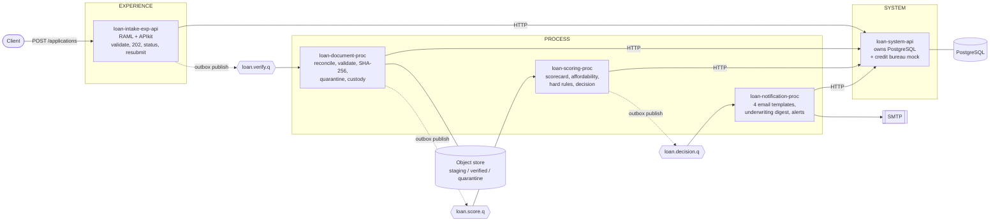
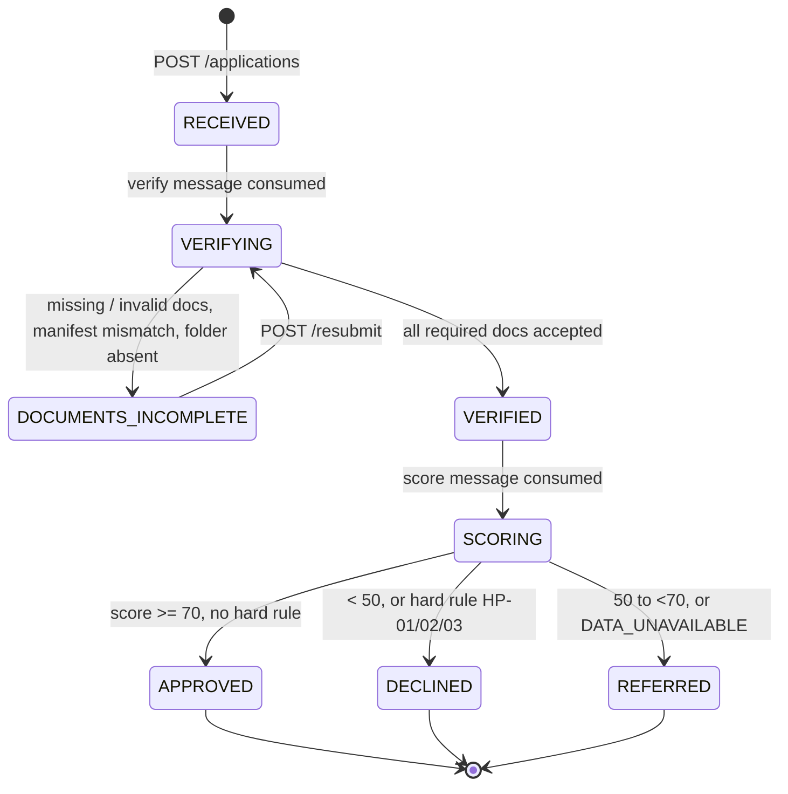
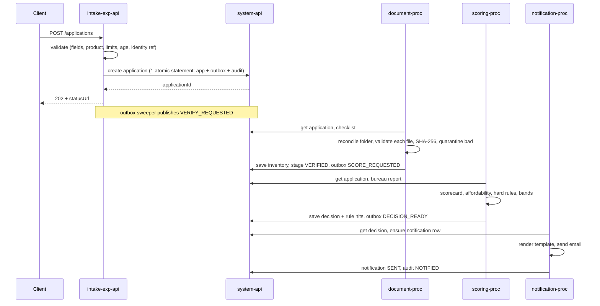

# High Level Design: Loan Application Processing

**Version:** 0.1 draft (Day 1, 4 Nov 2026) · **Status:** living document, updated at the end of every build phase · **Author:** Aritra
**Challenge:** Cognizant NPN Hackathon, Use Case 22, Banking Loan Application Processing (MuleSoft)

Legend for status tags: **[built]** implemented and verified, **[designed]** decided but not yet built.

---

## 1. Purpose and scope

The platform accepts loan applications over HTTP, reconciles the uploaded supporting documents against a per-product checklist, scores credit asynchronously with an explainable scorecard, stores an auditable decision, and emails the applicant one of four outcomes: **APPROVED, DECLINED, REFERRED, DOCUMENTS_MISSING**.

Design drivers, taken from the brief:
1. **The file system sits in the middle of the flow.** The payload only references documents uploaded separately, so the integration must reconcile a payload against a folder.
2. **Missing documents are a business outcome, not an error to retry.**
3. **Scoring is a regulated decision.** Inputs, rules, weights and the scorecard version must be reconstructable months later.
4. **Fast acknowledgement.** The API answers `202` without reading documents or scoring.
5. **Never approve on incomplete data.** Degrade to REFERRED / DATA_UNAVAILABLE.
6. **Safe under redelivery and failure.** Duplicates, broker outages and SMTP outages must not create duplicate decisions or lose work.

Out of scope: real credit-bureau integration (a mock is used), real document OCR, applicant-facing UI, payment disbursement.

## 2. Architecture overview

API-led connectivity with three layers, five Mule 4 applications, three queues.

| Layer | App | Responsibility |
|---|---|---|
| Experience | `loan-intake-exp-api` | Public API: validate, idempotent intake, `202` + status URL, status endpoint, resubmit |
| Process | `loan-document-proc` | Consume verify messages, reconcile and validate documents, quarantine, custody |
| Process | `loan-scoring-proc` | Consume score messages, call bureau mock, scorecard, affordability, decision |
| Process | `loan-notification-proc` | Consume decision messages, send email, underwriting digest, monitoring |
| System | `loan-system-api` | **Only component that talks to PostgreSQL**; also hosts the bureau mock |

**Why this shape**
- **Queues between process apps** isolate slow work (bureau, large document sets) from the API response.
- **A single system API owns the database** so business-level operations can be atomic (for example "create application + outbox message + audit row" is one statement) and SQL lives in one place.
- **Each app is separately deployable** and testable alone with sample messages.

## 3. Application lifecycle

- Stages describe the **loan only**. Notification progress is tracked separately (`PENDING, RETRYING, SENT, FAILED`), so an approved loan stays approved if SMTP is down.
- `NOTIFIED` is not a stage; it is the audit event written when a notification reaches `SENT`.
- Naming: `DOCUMENTS_INCOMPLETE` is the application status everywhere; `DOCUMENTS_MISSING` is only the fourth outcome and its email template.

### Happy path (sequence)

## 4. Component design

### 4.1 loan-intake-exp-api (experience) [designed]
- RAML-first with APIkit router. Endpoints: `POST /applications`, `GET /applications/{id}/status`, `POST /applications/{id}/resubmit`.
- Validation: mandatory fields (400 with field-level errors), unknown product (422), amount or tenure outside limits (400/422 stating limits), applicant age at application, malformed identity reference. Age at maturity is **not** checked here; it is hard rule HP-01 at scoring.
- Idempotency: the client `requestId` is the key. Same id + same payload hash returns the original `applicationId`; same id + different payload returns `409`.
- Does no file reads and no scoring. Database down returns `503`, never a false `202`.
- Autodiscovery and policies (client-id enforcement, rate limiting) on this API.

### 4.2 loan-document-proc (process) [designed]
1. Consume `loan.verify.q`; dedupe by `messageId`.
2. Read the product checklist (cached with a short TTL so edits apply without redeploy).
3. List the applicant folder; wait until each file size is stable (object store snapshot of sizes) before verifying.
4. Classify every entry: expected and present, expected and missing, present but unexpected (ignored).
5. Validate each file with a capped **parallel for-each**: extension, content type by magic bytes (a renamed executable is caught), size from metadata (never loaded in full), non-zero, readable first block, SHA-256 by streaming. Duplicate content is detected by digest and counted once.
6. Quarantine failures with a reason code; compare manifest count and checksums (`MANIFEST_MISMATCH`).
7. Copy accepted files to `verified/<applicationId>`, record source path, stored path and digest, then remove the staging copy only after the inventory write succeeds. Files are never modified in place.
8. Complete: stage `VERIFIED` + outbox `SCORE_REQUESTED`. Incomplete: stage `DOCUMENTS_INCOMPLETE` + outbox for the notification. Resubmission skips already-accepted files.

### 4.3 loan-scoring-proc (process) [designed]
- Consume `loan.score.q`; call the bureau mock and read applicant history.
- **Decision order:** (1) bureau or history unreadable gives REFERRED / DATA_UNAVAILABLE and stops; (2) hard rules: HP-01 age at maturity above product maximum, HP-02 active default, HP-03 EMI above ceiling with no valid reduced amount; (3) score bands.
- **Scorecard SC-1.0**, five factors, linear points between two end values, contribution = weight × points / 100, score = sum:

| Factor | Weight | 0 points at | 100 points at |
|---|---|---|---|
| Credit bureau score | 35 | ≤ 600 | ≥ 750 |
| Debt-to-income (obligations + new EMI over income) | 20 | ≥ 60% | ≤ 30% |
| Loan-to-income (amount over annual income) | 15 | ≥ 5× | ≤ 1× |
| Employment stability (months in job) | 15 | ≤ 6 | ≥ 36 |
| Repayment history (missed payments in 24 months) | 15 | ≥ 3 | none |

- **Affordability:** `EMI = P·r(1+r)^n / ((1+r)^n − 1)`, `r = annual rate / 1200`, rounded to 2 decimals half-up. Net income = declared income − declared obligations. If EMI / net income exceeds the product ceiling, reduce to the largest multiple of 1,000 that fits and approve with reason `AFFORDABILITY_REDUCED` if it is still at least the product minimum; otherwise HP-03 declines.
- Bands: ≥ 70 APPROVED, 50 to < 70 REFERRED, < 50 DECLINED. Offer valid 30 days. Every factor and hard rule is saved with value, weight, points, contribution and the scorecard version.
- One decision per application, enforced by a unique key.

### 4.4 loan-notification-proc (process) [designed]
- Consume `loan.decision.q`. Four templates: APPROVED (terms, next steps, any reduction and reason), DECLINED (plain-language reasons and the right to request a review; **no scores or rule ids**), REFERRED (expected timescale), DOCUMENTS_MISSING (exact list: type, required count, found count, how to supply).
- One email per application + template + verification round (unique key). SMTP failure keeps the decision and retries only the notification with bounded backoff; unnotified decisions are listed and alerted.
- Underwriting digest scheduler for REFERRED applications with age and amount.
- Batch job for the outbox sweep; Anypoint Monitoring alerts on DLQ depth and unnotified decisions.

### 4.5 loan-system-api (system) [built: complete]
- RAML contract with about 30 business-level operations; only this app opens JDBC connections.
- **Applications:** `POST /applications` (application, outbox message and audit row in one statement, idempotent on request id), `GET /applications/{id}`, `GET /applications?stage=&limit=` (for the underwriting digest), `PUT /applications/{id}/stage` (expected-stage guard, row lock, audit and optional outbox message in one statement), `POST /applications/{id}/resubmit` (only from `DOCUMENTS_INCOMPLETE`, one concurrent winner), `PUT /applications/{id}/documents` (transactional upsert of the inventory), `POST /applications/{id}/decision` (decision, rule hits, stage change, audit row and `DECISION_READY` outbox message in one transaction; a repeat changes nothing), `GET /applications/{id}/audit`.
- **Reliability:** `GET /outbox/pending`, `POST /outbox/{id}/sent`, `POST /outbox/{id}/failed`, `POST /processed-messages` (claim) and `DELETE /processed-messages/{consumer}/{messageId}` (release), `POST /audit/events`.
- **Reference data and mocks:** `GET /products/{code}`, `GET /products/{code}/document-rules`, `GET /scorecards/active`, `GET /bureau/reports/{identityRef}` (503 while the switch is off, 404 for an applicant without history), `GET` and `PUT /bureau/switch`.
- **Notifications:** `POST /notifications` (one row per application, template and round), `PUT /notifications/{id}`, `GET /notifications` (unnotified rows with their age).
- Global error handler, encrypted secrets, request log with identity numbers masked, UTC timestamps; 57 MUnit tests (91.5% coverage) and a live smoke script with 77 checks.
- Outbox delivery is at least once; every consumer dedupes by `messageId` through the claim. A consumer releases its claim after a technical failure so a redelivery is not skipped.
- The bureau mock takes the identity number in the URL path for simplicity; the request log masks it. A real bureau integration would use a request body instead.

## 5. Messaging design

| Queue | Producer | Consumer | Message type |
|---|---|---|---|
| `loan.verify.q` | intake (via outbox), resubmit | document-proc | `VERIFY_REQUESTED` |
| `loan.score.q` | document-proc | scoring-proc | `SCORE_REQUESTED` |
| `loan.decision.q` | scoring-proc | notification-proc | `DECISION_READY` |

Each queue has a `.dlq`. **Envelope (ids only, never identity numbers or income):**
`{ messageId, correlationId, applicationId, type, attempt, createdAt }`. Consumers read details from the database.

**Retry and dead letter (one strategy).** Manual acknowledgement. Technical failures (database, broker, SMTP) are retried 3 times with waits of 2, 4 and 8 seconds; then the message goes to the `.dlq` with the failure reason and attempt count and is acknowledged. Business outcomes (missing documents, DATA_UNAVAILABLE, declines) are results, never retries. An unparseable message goes straight to the DLQ.

## 6. Data design (PostgreSQL) [built]

14 tables, defined in `db/schema.sql`:

| Group | Tables |
|---|---|
| Reference | `products`, `product_document_rules`, `scorecard_versions`, `scorecard_config`, `applicant_history`, `system_flags` |
| Transactional | `applications`, `application_documents`, `credit_decisions`, `decision_rule_hits`, `notifications` |
| Reliability and audit | `outbox`, `processed_messages`, `decision_audit` |

Integrity rules that carry the design:
- `applications.request_id` UNIQUE: idempotent intake.
- `credit_decisions.application_id` PRIMARY KEY: one decision per application, so a redelivered scoring message changes nothing.
- `notifications (application_id, template, round)` UNIQUE: one email per outcome per verification round; a resubmit may legitimately need a new documents-missing email.
- `processed_messages (consumer, message_id)` PRIMARY KEY: consumer-level dedupe.
- `application_documents`: unique `(application_id, source_path)` for safe re-verification; partial unique index on `(application_id, sha256)` for accepted files counts duplicate content once.
- `decision_audit` is **append-only**, enforced by a database trigger that rejects UPDATE and DELETE.
- Checklist, product limits and scorecard weights/thresholds are **data**, so they change without redeployment, and every decision records its scorecard version.

## 7. Cross-cutting design

### 7.1 Reliability
- **Transactional outbox:** a message to publish is written in the same statement as the business change; a sweeper publishes it. A broker outage never leaves an acknowledged application without a verification path.
- **Idempotency at three levels:** request id (intake), unique decision key (scoring), unique notification key (notification), plus the processed-message claim for consumers. Database keys are the real guard because they survive restarts.
- **Conservative degradation:** no readable bureau or history means REFERRED, never APPROVED.

### 7.2 Error handling [built in system API; pattern copied to every app]
One global error handler maps error types to a stable JSON body and HTTP status: 400, 404, 405, 406, 409, 415, 422, 501, 503 (database or dependency down), 500. Business errors are raised in one place (`sf-raise-app-error`). Technical errors return a generic message so no internal detail or submitted value leaks; logs carry only status, error type and correlation id.

### 7.3 Security and privacy
- Identity numbers, income figures and document content never appear in logs, queue messages or decline emails.
- Credentials live in encrypted properties (`![...]`, AES/CBC); the key is supplied at run time and never committed. The packaged artifact contains no plain-text credential.
- Policies (client-id enforcement, rate limiting) on exposed APIs; autodiscovery per environment.
- Path-traversal protection on the manifest folder field.

### 7.4 Observability
- Correlation id on every request and every audit row; reconstruct RECEIVED to NOTIFIED from `decision_audit` (AC 15).
- Log levels: INFO for milestones, DEBUG for detail, ERROR for failures, with no sensitive data.
- Anypoint Monitoring alerts: DLQ depth, unnotified decisions.

### 7.5 Configuration
`config-{env}.yaml` (plain) and `secure-{env}.yaml` (encrypted), selected by `mule.env` (`local` or `cloudhub`). DataWeave in `/dwl`, SQL in `/sql`. The same code runs on a laptop and on CloudHub; only the files and the run-time key differ.

### 7.6 Standards mapping

| # | Standard | Where it is addressed |
|---|---|---|
| 1 | HLD | this document |
| 2 | API-led | section 2 |
| 3 | Global error handling | 7.2 |
| 4 | RAML + APIkit | every HTTP API |
| 5 | MUnit | alongside each flow; coverage report in Phase 7 |
| 6 | Autodiscovery | per exposed API, Phase 7 |
| 7 | Externalized and secure properties, dwl | 7.5 |
| 8 | Logging levels | 7.4 |
| 9 | API policies | 7.3 |
| 10 | Private and sub-flows | main flows read as a story; detail in `sf-` and `pf-` flows |
| 11 | Core components | parallel for-each (documents), DataWeave scorecard, choice, validation module |
| 12 | Alerts, monitoring | 7.4 |
| 13 | Git with merge requests | feature branches and PRs |
| 14 | Batch, cache, object store | batch: outbox sweep and digest; cache: product checklist and scorecard; object store: file-size stability snapshots |
| 15 | Standard names | `<app>-<purpose>-flow`, `sf-` sub-flows, `pf-` private flows |
| 16 | PostgreSQL, CloudAMQP | Docker locally, hosted in the cloud |

## 8. Deployment and environments

| Concern | Local (laptop) | CloudHub 1.0 (Sandbox) |
|---|---|---|
| Runtime | Mule 4.12 EE in Anypoint Code Builder / Studio | Mule 4.12, 0.2 vCore for system API and document-proc, 0.1 for the others |
| Database | Docker PostgreSQL 16 | Hosted PostgreSQL (e.g. Neon or Supabase) |
| Queues | Docker RabbitMQ | CloudAMQP |
| Documents | Docker MinIO (S3 API) | S3-compatible bucket |
| Email | MailHog | Mailtrap or SMTP |
| Secrets | secure properties, key as run-time argument | key as an application property in Runtime Manager |

Constraint: the trial has 1 vCore in Sandbox and no VPC, so everything uses public endpoints on CloudHub 1.0. Worker disk is lost on restart, which is why documents live in external storage.

## 9. Test and acceptance strategy
- MUnit alongside each flow: each outcome, missing-document path, oversized document, manifest mismatch, resubmission, bureau degradation and redelivery, runnable in one command.
- Live curl checks per phase, because mocked tests cannot catch SQL or wiring errors.
- End-to-end demo script covering the 17 acceptance criteria; replay script (10× redelivery); log-scan script (no identity number, income or document content).

## 10. Risks and open decisions

| Item | Status |
|---|---|
| Mule S3 connector against a MinIO custom endpoint | untested; SFTP fallback prepared in Docker |
| Five apps in 1 vCore Sandbox | design assumes fit; deploy one app early to confirm |
| Small heap on 0.1 vCore | lean dependencies, small connection pools |
| MUnit coverage target of 100% | tracked from the start; reasoned gaps documented |
| Policy support on the trial | in-app policies or the one Small Managed Omni Gateway |

## 11. Change log
| Date | Change |
|---|---|
| 2026-11-04 | v0.1 draft: architecture, lifecycle, components, data, cross-cutting design |
| 2026-11-05 | v0.2: system API now includes stage change, resubmit, outbox, processed-message claim and release, audit append and read |
| 2026-11-05 | v0.3: system API complete: products, document rules, scorecard, document inventory, decision save, bureau mock and switch, notifications, application list |
